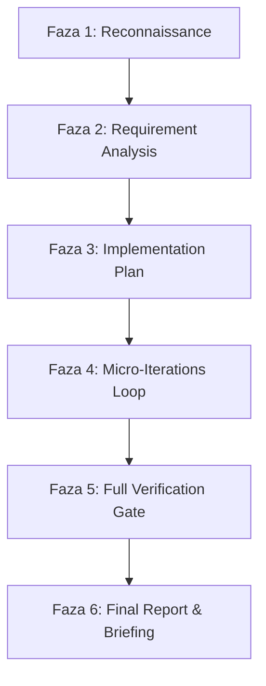

# .NET 10 Technical Exam Orchestrator

This skill coordinates the end-to-end implementation of features during a practical examination on an ASP.NET Core .NET 10 Minimal API codebase. It enforces methodical pacing, rigorous architectural discipline, micro-iteration delivery, transaction management, and coordinates the available specialized skills without over-engineering.

---

## 1. Exam Restrictions & Student Ownership

> [!IMPORTANT]
> **Candidate Documentation Boundary:**
> Three documentation files are exclusively authored and maintained by the candidate:
> 1. `DECIZII.md` (Technical and architectural design decisions)
> 2. `BUGURI.md` (Defects discovered, edge cases, root causes, and resolutions)
> 3. `AI-LOG.md` (Log of prompts and AI interactions)
>
> **Mandatory Agent Rules:**
> - **NEVER** create, edit, overwrite, or touch `DECIZII.md`, `BUGURI.md`, or `AI-LOG.md`.
> - **Never implement architectures not asked for**: Do not add microservices, outboxes, event brokers, or third-party libraries (e.g. MediatR) unless explicitly required.
> - **Never sacrifice invariants or data integrity**: Speed is secondary to correctness.
> - **Ambiguity Protocol**: If a requirement is ambiguous, state the **minimal viable assumption** and explain it before implementing.

---

## 2. The 6-Phase Exam Protocol



---

### Faza 1 — Reconnaissance (Inspect Before Modifying)

Before making any modifications or writing code:
1. **Inspect Projects**: Locate all `.csproj` files (`src/`, `tests/`).
2. **Read Project Setup**:
   - Inspect `.csproj` for `TargetFramework` (`net10.0`), `Nullable`, `ImplicitUsings`, and package versions.
   - Inspect `Program.cs` for DI setups, middleware pipeline, and route mappings.
   - Inspect `appsettings.json` for SQLite connection strings and environment keys.
3. **Discover Existing Building Blocks**:
   - Identify existing `Result<T>` and `Error` types.
   - Identify Domain entities, Value Objects, and base classes.
   - Identify existing `DbContext` and Repository / Unit of Work patterns.
   - Check if Handlers or CQRS conventions exist.
4. **Identify Existing Tests**:
   - Determine test framework (`xUnit`, `NUnit`, `MSTest`).
   - Run a baseline build and test check:
     ```powershell
     dotnet build --no-incremental
     dotnet test
     ```
5. **Rule**: **Do NOT modify any file before completing this reconnaissance phase.**

---

### Faza 2 — Requirement Analysis

Break down the user's exam requirement into concrete technical artifacts:
1. **Behavioral Breakdown**: Split into specific operations (e.g., Create, GetById, Publish, Cancel).
2. **Domain Impact**: Identify affected entities, new Value Objects, invariant rules, and state transitions.
3. **HTTP Contracts**: Identify endpoints, route parameters, route constraints (e.g. `{id:guid}`), request DTOs, and response DTOs.
4. **Persistence Impact**: Identify table configurations, composite indexes, foreign keys, and migration needs.
5. **Scenario Matrix**: Map happy paths (200/201) and negative paths (400 Bad Request, 404 Not Found, 409 Conflict).
6. **Regression Risk Assessment**: Identify existing code or tests that could break.

---

### Faza 3 — Implementation Plan & Skill Activation

Present a concise plan to the candidate before editing files:

```markdown
### 📝 Plan de Implementare (Increment)
1. **Domain Changes**: [Entitate, Value Object, Invariante, Fabrică statică Create]
2. **Persistence**: [IEntityTypeConfiguration, Repository methods, IUnitOfWork]
3. **Handler**: [Command record, Custom Handler, CancellationToken]
4. **Endpoint**: [Folderul Features/<Group>/<UseCase>/, Request, Response, TypedResults]
5. **Dependency Injection**: [Înregistrare Scoped în Program.cs / AddHandlers]
6. **Tests**: [Domain Unit Tests, Handler Tests, API Integration Tests]
```

#### Skill Activation Matrix:
- Activate **`dotnet-rich-domain-result`** for domain modeling and invariant protection.
- Activate **`dotnet-vertical-slice`** for structuring the feature folder and thin endpoint.
- Activate **`dotnet-cqrs-handlers`** for command, handler, and assembly scan registration.
- Activate **`dotnet-efcore-persistence`** for EF Core configurations and SQLite mappings.
- Activate **`dotnet-repository-unit-of-work`** for repository interfaces and DI forwardings.
- Activate **`dotnet-testing-strategy`** for unit, persistence, and integration tests.
- Activate **`dotnet-code-quality-review`** for final quality audit.

---

### Faza 4 — Micro-Iterations Protocol (Incremental Delivery)

> [!WARNING]
> **Never implement a large feature in a single massive operation.**
> Divide the implementation into 6 strictly ordered, independent, and verifiable micro-steps:

```text
[Step 1: Domain] ───────> Verify: dotnet build + Domain Unit Tests
       ↓
[Step 2: Persistence] ──> Verify: dotnet build + Schema check
       ↓
[Step 3: Handler] ──────> Verify: dotnet build + Handler Unit Tests
       ↓
[Step 4: Endpoint] ─────> Verify: dotnet build + Route check
       ↓
[Step 5: Tests] ────────> Verify: dotnet test (All suites passing)
       ↓
[Step 6: Final Review] ─> Verify: dotnet-code-quality-review (20-point rubric)
```

#### Micro-Iteration Rules:
1. **Never Advance with Errors**: Do not proceed to the next micro-step if the current step has compilation errors or regressions.
2. **No Speculative File Creation**: Do not create stub files or empty classes in advance without an immediate concrete need in the current micro-step.
3. **Immediate Regression Fix**: If adding a handler breaks an existing unit test, resolve the breakage immediately before touching endpoints.

---

## 3. Database Transaction Discipline

To prevent partially saved data, race conditions, or silent rollback failures while avoiding over-complicated architectures:

### 1. The Single Commit Boundary
- **`Repository.Add` never saves**: Its sole responsibility is registering the entity with the EF Core `ChangeTracker` (`EntityState.Added`).
- **`UnitOfWork` controls `SaveChangesAsync`**: The custom Handler triggers the persistence boundary via `await unitOfWork.SaveChangesAsync(cancellationToken)`.
- **Single Scoped DbContext**: All Repositories and `IUnitOfWork` must resolve the exact same `Scoped` instance of `DbContext`.
  ```csharp
  services.AddDbContext<CampusHubDbContext>(...);
  services.AddScoped<IUnitOfWork>(sp => sp.GetRequiredService<CampusHubDbContext>());
  ```

### 2. Avoid Multiple `SaveChangesAsync` in a Single Use Case
- In standard business operations, a single call to `SaveChangesAsync` at the end of the Handler encapsulates all additions, updates, and removals in an atomic database transaction provided automatically by EF Core.
- Avoid calling `SaveChangesAsync` multiple times in the same handler. Multiple saves introduce the risk of partial data commits if an intermediate save succeeds and a later save throws an exception.

### 3. Explicit Transactions (`BeginTransactionAsync`) — When and When NOT to Use
- **Do NOT** create explicit transactions inside Repository methods.
- **Do NOT** assume an explicit transaction is necessary for every Handler (a single `SaveChangesAsync` is already atomic in SQLite).
- **Use explicit transactions ONLY** when:
  1. A complex business operation requires multiple distinct `SaveChangesAsync` calls (e.g., generating an ID from a sequence table, then inserting rows in another table).
  2. The operation coordinates multiple DbContexts or external stores.
  ```csharp
  // Use explicit transaction only when multiple SaveChangesAsync are unavoidable:
  await using var transaction = await dbContext.Database.BeginTransactionAsync(cancellationToken);
  try
  {
      await unitOfWork.SaveChangesAsync(cancellationToken);
      // secondary operation...
      await unitOfWork.SaveChangesAsync(cancellationToken);
      await transaction.CommitAsync(cancellationToken);
  }
  catch
  {
      await transaction.RollbackAsync(cancellationToken);
      throw;
  }
  ```

### 4. SQLite Provider Concurrency & Locking
- SQLite uses database-level write locks. Concurrent write transactions will cause `database is locked` / `busy` exceptions.
- Keep transaction lifetimes as short as possible. Never execute remote HTTP calls, heavy CPU hashing, or external file I/O while holding an active transaction.

---

## 4. Faza 5 — Full Verification Gate

Run the complete verification suite across the whole solution:

1. **Clean Compilation**:
   ```powershell
   dotnet build --no-incremental
   ```
   *Requirement: 0 Errors, 0 Warnings.*
2. **Execute Full Test Suite**:
   ```powershell
   dotnet test --logger "console;verbosity=normal"
   ```
   *Requirement: 100% of tests passing. Never claim tests passed without executing this command.*
3. **Audit Endpoints & Status Codes**: Verify `201`, `200`, `400`, `404`, `409` and RFC 7807 `ProblemDetails`.
4. **Audit Domain Rules**: Confirm invariant guard clauses cannot be bypassed.
5. **Audit Persistence & DI**: Ensure `IUnitOfWork` resolves the same `Scoped` DbContext instance as repositories.
6. **Point-by-Point Requirement Check**: Match each sentence of the exam requirement to working code.

---

## 5. Faza 6 — Final Report & Student Briefing

Present a concise final report structured as follows:

```markdown
# 🏁 Raport Final Examen

## 1. Ce s-a implementat
- [Descrierea pe scurt a funcționalităților finalizate]

## 2. Fișiere create / modificate
- `src/.../File1.cs`
- `tests/.../File1Tests.cs`

## 3. Teste executate și rezultate
- Total teste: [X] | Trecute: [X] | Eșuate: [0]
- [Listă teste cheie validate]

## 4. Ce mai trebuie verificat manual
- [Verificări specifice de mediu sau explorare Swagger UI]

---

### 📋 Briefing pentru documentația personală (Examen)

**Pentru DECIZII.md:**
- [Decizia arhitecturală cheie: de ex. delimitarea tranzacției atomice prin UnitOfWork].
- [Decizia de persistență: de ex. Value Object mapping via ComplexProperty].

**Pentru BUGURI.md:**
- [Edge case-ul tratat: de ex. prevenirea salvării parțiale prin apel unic SaveChangesAsync].
- [Tratarea erorilor prin Result.Failure(Error) în locul excepțiilor].

**Pentru AI-LOG.md:**
- [Sinteză prompt: ex. "Implementat use-case cu micro-iterații și gestiunea tranzacțiilor pe SQLite"].
```

---

## 6. Anti-Patterns to Reject

- ❌ Writing code before Faza 1 reconnaissance.
- ❌ Generating all layers at once without verifying intermediate micro-steps.
- ❌ Creating or touching `DECIZII.md`, `BUGURI.md`, or `AI-LOG.md`.
- ❌ Calling `SaveChangesAsync` inside repository methods (`Repository.Add`).
- ❌ Multiple unneeded `SaveChangesAsync` calls within a single handler.
- ❌ Opening explicit transactions inside repositories or for simple single-save operations.
- ❌ Claiming tests passed without running `dotnet test` in the terminal.
- ❌ Leaving `// TODO` or compilation warnings in the codebase.

---

## 7. References & Examples
- Exam Protocol & Micro-iterations checklist: [exam-workflow-checklist.md](file:///d:/Facultate/dotNet/Partial/.agents/skills/dotnet-exam-orchestrator/references/exam-workflow-checklist.md)
- Step-by-step example runbook: [sample-exam-runbook.md](file:///d:/Facultate/dotNet/Partial/.agents/skills/dotnet-exam-orchestrator/examples/sample-exam-runbook.md)
